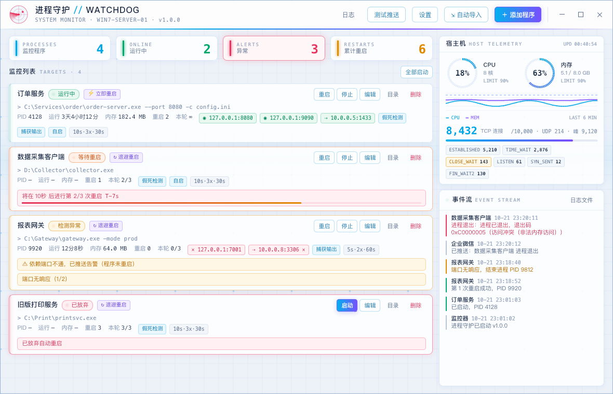
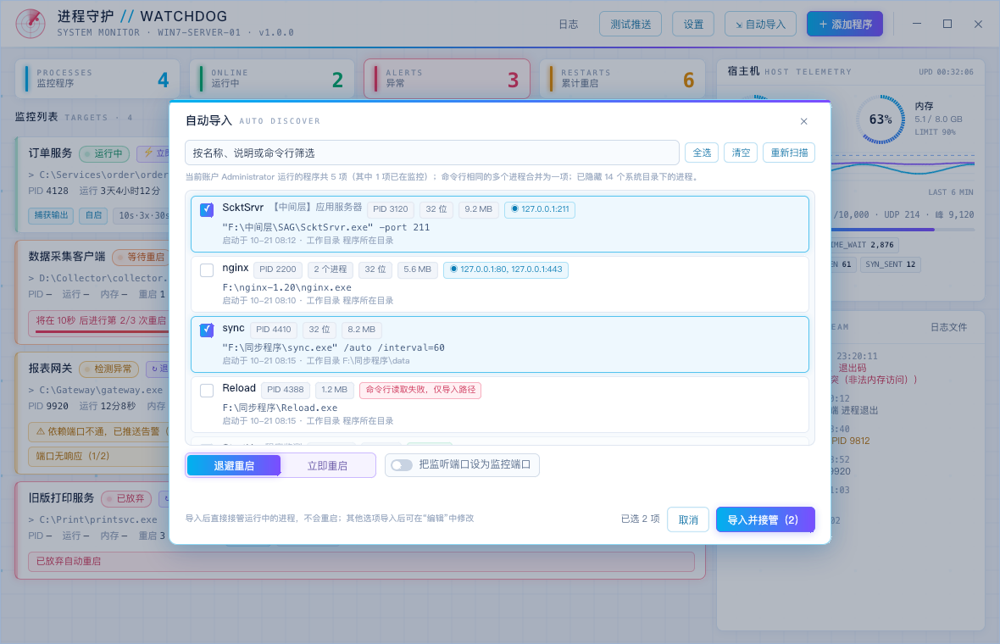

[中文](README.md) | English

# Watchdog

[](https://github.com/chenlz22550/watchdog/actions/workflows/build.yml) [](https://github.com/chenlz22550/watchdog/releases/latest)

A Windows process guardian. It restarts a monitored program when the process exits, a window stops responding, or a configured port does not accept a TCP connection, and it sends the reason to a WeCom (企业微信) group robot.

- **Windows 7 / Server 2008 R2 and later.** Built with Go 1.20, the last Go release that supports Windows 7. The executable links the system `msvcrt.dll`. It does not need the Visual C++ runtime or KB2999226.
- **UI.** Sciter, light theme. CPU and memory ring gauges and an about-6-minute history refresh while the window is open. Other elements change color only when status changes (the header radar changes color with status and does not sweep). Borderless window and a drawn title bar; the same UI is used on the classic theme.
- **Two files.** `watchdog.exe` and `sciter.dll`. Release zips already include the matching `sciter.dll`.

<!--
TODO: add a short demo at docs/demo.gif (main window, import, one restart). After the file is in the repo, remove this comment and use:

-->

<!--
TODO: add a WeCom alert screenshot at docs/wecom-alert.png. After the file is in the repo, remove this comment and use:

-->



## Compared with NSSM and WinSW

NSSM and WinSW install a program as a Windows service and start it in the service session. Watchdog is not a service. It runs in the signed-in user's session (system tray; the startup entry is the current user's `Run` key) and does not register a Windows service. The table does not compare "start before anyone logs on."

Supervisor is not in the table. Its documentation says it will not run on any version of Windows.

Third-party cells follow published docs. These programs were not run from this repo. "Not documented" means the pages listed below do not describe that behavior. It is not a claim that every source file was read.

| | Watchdog | NSSM (2.24 docs on nssm.cc) | WinSW 3 |
| --- | --- | --- | --- |
| Windows 7 / Server 2008 R2 | Yes. Go 1.20, links `msvcrt.dll`, no Visual C++ runtime and no KB2999226 | Documented as Windows 2000 or later, and Windows 7 is named. Server 2008 R2 falls under "2000 or later"; the page does not name it | .NET Framework build: Windows 7 SP1 and Server 2008 R2 SP1, if .NET Framework 4.6.1 or later is installed. The .NET 7 builds do not support these versions (documented minimum is Windows 10 1607 / Server 2012 R2) |
| Restart after the process exits | Yes. Per program: backoff (1s, 10s, 100s, then stop after 3 attempts) or immediate restart | Yes. The default action when the application exits is Restart. Restarts are throttled if it exits immediately | Only if you set `<onfailure action="restart">`. The docs define failure as a non-zero exit code. With no `onfailure` entry, that action is not configured |
| Hung-window detection | Yes, optional per program. `IsHungAppWindow`; after N consecutive hits the process tree is stopped and the program is restarted | Not documented. Documented monitoring is process exit | No automatic check is documented. `winsw dev kill` is a manual command, not a periodic check |
| Port check | Yes. TCP connect to configured addresses (3s timeout); N consecutive failures stop and restart the program. Dependency addresses alert only and do not restart it | Not documented | Not documented |
| WeCom alert | Yes. Robot webhook, markdown | Not documented. Progress is written to the Windows Event Log | Not documented. Stdout/stderr go to log files; service-side errors go to the Windows Event Log |
| GUI | Yes. Window for monitoring and configuration | Yes. A GUI to install and edit the service (since 2.22 it covers the configuration the CLI can set). Not a live status view | No. Command line and an XML file |
| Adopt a process that is already running | Yes. Import attaches and does not restart it. On the next launch, a program set to start automatically is attached again using the saved PID | Not documented. When the service starts, NSSM starts the configured program | Not documented. When the service starts, it starts the configured `<executable>` |

Sources:

- NSSM: [download](https://nssm.cc/download) (Windows 2000 or later), [description](https://nssm.cc/description) (restart on exit, Event Log, GUI), [usage](https://nssm.cc/usage) (exit actions, throttle, I/O).
- WinSW 3: [supported platforms](https://winsw.github.io/v3/), [XML config](https://winsw.github.io/v3/docs/xml-config-file/) (`onfailure`), [CLI](https://winsw.github.io/v3/docs/cli-commands/) (`dev kill`), [troubleshooting](https://winsw.github.io/v3/docs/troubleshooting/) (Windows 7 needs .NET Framework 4.6.1+), [logging](https://winsw.github.io/v3/docs/logging-and-error-reporting/).
- Supervisor: [platform requirements](https://supervisord.org/introduction.html) (does not run on Windows).

## Features

### Process guard
- Any number of programs (`.exe` / `.bat` / `.cmd`). Each one has its own arguments, working directory (default: the program's directory), check interval, and failure threshold.
- Three checks:
  - **Process exit.** The exit code is recorded and labeled, for example `0xC0000005` (access violation) and `0xC0000409` (stack buffer overrun).
  - **Hung window.** `IsHungAppWindow`. After the threshold, the process tree is stopped and the program is restarted.
  - **Port not accepting.** TCP connect to the configured address (3 second timeout). After N consecutive failures the process tree is stopped and the program is restarted.
- Restart policy, per program:
  - **Backoff.** Wait 1s, then 10s, then 100s, at most 3 times. If it is still failing, automatic restart stops and an alert is sent. The counter resets after 10 minutes of steady running.
  - **Immediate.** No attempt limit. If the program file cannot be started, retry every 5 seconds.
- Optional "hide the window and capture output." Console output is written to a log. An alert includes the last 15 lines (bytes that are not UTF-8 are decoded as GBK).

### Import running programs
Scan programs running as the signed-in user and import a selection:
- Reads the full command line and the working directory from process start, and fills in path, arguments, and working directory.
- Processes with the same command line (for example nginx master and workers) are one entry.
- After import, Watchdog attaches to the running process and does not restart it. Processes under the system directory are hidden. A program that is already monitored is not imported again.



### WeCom
- An alert is sent for each failure and for each restart (success or failure): failure kind, exit-code text, runtime, memory, crash module from the Windows event log, and the last 15 lines of output.
- **Dependency addresses.** Each program can list addresses it depends on (for example a database at `10.0.0.5:1433`). A failed connect sends an alert; recovery sends a recovery notice. The program is not restarted.
- Settings has a "test push" button that sends one message so the robot configuration can be checked.
- Messages are sent one at a time, with retries. WeCom rate limit `45009` waits and then sends again.

WeCom is the only alert channel. DingTalk, Feishu, and a generic webhook are not implemented. See Roadmap.

### Host
- CPU and memory (ring gauge and about 6 minutes of history) and TCP connection counts by state (ESTABLISHED, TIME_WAIT, CLOSE_WAIT, and the other states returned by the table).
- Thresholds: CPU / memory alert only after they stay over the limit (default 90% for 30 seconds). Connection count alerts immediately (default 10000).
- The alert lists the top 5 processes by that resource. A recovery notice is sent when the value falls back. While it stays over the limit, a reminder is sent every 30 minutes.

### Other
- **Tray.** Closing the window hides it. Monitoring continues. The tray icon color follows overall status. A failure shows a balloon.
- **Start with Windows.** Written to the current user's `Run` key. That launch uses `--tray`, so the window stays in the tray.
- **Quitting does not stop monitored programs.** Quit only stops monitoring. On the next launch, programs set to start automatically are attached again using the saved PID. If that PID has exited, or the PID now belongs to a different program, Watchdog starts the program.
- **Local logs** (`logs` directory):
  - `alerts-YYYYMMDD.log`: alert text and whether the push succeeded;
  - `watchdog-YYYYMMDD.log`: events;
  - `<program-id>.out.log`: captured program output. The next time that log is opened, if it is already over 10 MB, the current file is renamed to the same name with `.1`.

## Use

1. Download the zip for the machine from [Releases](https://github.com/chenlz22550/watchdog/releases/latest) (it includes `sciter.dll`) and unzip it. Or build it and place the matching `sciter.dll` next to the exe (below).
2. Run `watchdog.exe`. In Settings, paste the WeCom robot webhook and use "test push".
3. Use "import" for programs that are already running, or "add program" to enter one.

`config.json` is stored next to the exe. Do not put the folder where the account cannot write.

## Build

Go **1.20.x** (Go 1.21 dropped Windows 7) and mingw-w64. Example cross-compile from macOS:

```bash
brew install mingw-w64
# Default compiler is gvm's go1.20.14. Override with GO=/path/to/go
./build.sh
# Optional: compile in a default robot URL
WEBHOOK='https://qyapi.weixin.qq.com/cgi-bin/webhook/send?key=...' ./build.sh
```

Output is `dist/x64` and `dist/x86`. `VERSION=v1.2.3` sets the version string compiled into the binary. `build.sh` fails the build if the exe imports UCRT (`api-ms-win-crt-*.dll`), which is missing on an unpatched Windows 7.

**sciter.dll:** Sciter **4.4.x** (this tree is written for 4.4.8, TIScript). It does not load under Sciter 5 / the JS build. Take `bin.win/x64/sciter.dll` or `bin.win/x32/sciter.dll` from the 4.4.8.x tag of [sciter-sdk](https://github.com/c-smile/sciter-sdk).

### Releases

GitHub Actions (`.github/workflows/build.yml`) cross-compiles on Ubuntu with Go 1.20 and mingw-w64. A push to `main` builds and uploads artifacts. A `v*` tag publishes a Release (x64 and x86 zips plus SHA256).

```bash
git tag v1.0.1 && git push origin v1.0.1
```

### UI preview (macOS)

`tools/uipreview` loads the same `ui/index.html` on macOS with fake data, so UI edits do not need a Windows machine each time:

```bash
go build -o uipreview ./tools/uipreview   # libsciter.dylib (Sciter 4.4.x) must sit next to the binary
./uipreview ui/index.html
```

## Layout

| File | What it is |
| --- | --- |
| `monitor.go` | Guard loop, restart policy, event and alert logs |
| `discover_windows.go` | Import: enumerate processes, read the command line from the PEB |
| `hostmon.go` / `connmon.go` | Host CPU, memory, and TCP connection monitoring |
| `notify.go` | WeCom push and message text |
| `winapi_windows.go` | Start, adopt, and stop processes; hung-window check; crash events |
| `tray_windows.go` | Tray icon and window subclassing |
| `ui/index.html` | The whole UI (Sciter + TIScript) |

## Roadmap

Not implemented. There is no setting for these yet:

- DingTalk robot
- Feishu (Lark) robot
- A generic webhook that is not tied to one vendor's message format

The current sender posts WeCom markdown only (`msgtype: markdown`).

## License

[MIT](LICENSE). Sciter is a separate engine. Its binaries are under [Sciter's own terms](https://sciter.com/prices/). Check those before commercial use.
